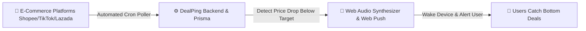

# 🌟 HƯỚNG DẪN TẠO PROFILE REPO ĐỂ ĐẸP TRANG CÁ NHÂN GITHUB (GITHUB PROFILE README)

> **Mẹo đặc biệt của GitHub**: Khi bạn tạo 1 repository trùng với tên username GitHub của bạn (`tranvoanhkiet2607-eng`), GitHub sẽ tự động ghim file `README.md` này lên ngay trang cá nhân `https://github.com/tranvoanhkiet2607-eng`. Ai vào trang bạn cũng sẽ thấy một Profile cực kỳ chuyên nghiệp, ấn tượng và đậm chất kỹ sư!

---

### 🚀 Cách làm trong 1 phút:
1. Vào GitHub: https://github.com/new
2. Ở ô **Repository name**, nhập chính xác: `tranvoanhkiet2607-eng`
3. Chọn chế độ **Public**
4. Tích vào ô **Add a README file**
5. Nhấn **Create repository**
6. Mở file `README.md` vừa tạo, dán toàn bộ đoạn mã bên dưới vào và bấm **Commit changes**!

---

### 📋 Mã mẫu README cho Profile của bạn:

```markdown
<div align="center">

# ⚡ TRAN VO ANH KIET 🌱
### *Software Developer • Passionate Learner*

<br/>

<p align="center">
  
</p>

<br/>

[](https://github.com/tranvoanhkiet2607-eng)
[](https://github.com/tranvoanhkiet2607-eng)
[](https://fpt.edu.vn)
[](https://vi.wikipedia.org/wiki/Vi%E1%BB%87t_Nam)
[](mailto:tranvoanhkiet2607@gmail.com)

<br/>

> 🌱 *"Every expert was once a beginner. Learning step by step every day."*

---

</div>

## 📌 About Me

Hello! I'm **Tran Vo Anh Kiet**, a software engineering student who loves coding, exploring new technologies, and learning through hands-on projects:

- 🎓 **Education**: Software Engineering student at **FPT University**.
- 🌱 **Currently Learning**: Practicing web development with React, TypeScript, and Node.js.
- 🚀 **Projects**: Working on **DealPing** with my friend for our university course (EXE101) to gain practical experience.
- 💡 **Mindset**: Humble, curious, and always open to constructive feedback, advice, and guidance from experienced developers.
- 💬 **Let's Connect**: Feel free to reach out to share knowledge or connect!

---

## 🛠️ Languages & Tools I'm Learning (Công Nghệ Đang Học & Thực Hành)

### 🎨 Frontend
<p>
  
  
  
  
  
  
  
</p>

### ⚙️ Backend & Databases
<p>
  
  
  
  
  
</p>

### 📲 Tools & Deployment
<p>
  
  
  
  
</p>

---

## 🤝 Collaborative & Team Ventures (Dự Án Đồng Phát Triển Cùng Bạn Bè)

> 👥 **Team Project**: *Dự án dưới đây được nghiên cứu, thiết kế và phát triển cùng bạn đồng hành trong khuôn khổ môn học **Khởi Nghiệp Đổi Mới Sáng Tạo (EXE101 — FA26)** tại **Trường Đại học FPT**.*

<div align="center">

### [⚡ DealPing — Flash Sale Price Tracker & Real-Time Radar](https://github.com/tranvoanhkiet2607-eng/Dealping_FlashSale)
*An intelligent cross-platform solution to track price drops on Shopee, TikTok Shop & Lazada, waking up devices with emergency siren alarms.*

<br/>



</div>

- 👥 **Team Synergy**: Dự án được hợp tác đồng phát triển bởi nhóm 2 thành viên, kết hợp giữa tư duy thiết kế sản phẩm và kỹ thuật lập trình Full-Stack.
- 📡 **Multi-Platform Link Resolver**: Bóc tách link sản phẩm từ Shopee (link thường + rút gọn), TikTok Shop và Lazada, trích xuất hình ảnh CDN và giá khuyến mãi thực tế.
- 🚨 **Multi-Tier Alarm Engine**: Còi hú Web Audio Synthesizer dồn dập, Dynamic Island Banner iOS và thông báo nền Web Push W3C đánh thức điện thoại cả khi khóa màn hình.
- 🫧 **Interactive Gamification**: Trò chơi nổ bong bóng deal mở khóa ô theo dõi thứ 2 với hiệu ứng vật lý sinh động.
- 🛠️ **Tech Stack**: React 19, TypeScript, Node.js 20, PostgreSQL, Prisma ORM, TailwindCSS 4, Web Audio API, Service Worker.

👉 **[Xem chi tiết mã nguồn dự án DealPing](https://github.com/tranvoanhkiet2607-eng/Dealping_FlashSale)**

---

## 📊 GitHub Analytics & Activity

<div align="center">


<br/>


</div>

---

## 📬 Get In Touch

<div align="center">

[](mailto:tranvoanhkiet2607@gmail.com)
[](https://github.com/tranvoanhkiet2607-eng)
[](https://github.com/tranvoanhkiet2607-eng/Dealping_FlashSale)

<br/>

**⭐ Thank you for visiting my profile! Wishing you a productive and inspired day! ⭐**

</div>
```
