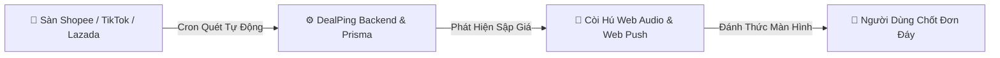

# 🌟 HƯỚNG DẪN TẠO PROFILE REPO ĐỂ ĐẸP TRANG CÁ NHÂN GITHUB (GITHUB PROFILE README)

> **Mẹo đặc biệt của GitHub**: Khi bạn tạo 1 repository trùng với tên username GitHub của bạn (`tranvoanhkiet2607-eng`), GitHub sẽ tự động ghim file `README.md` này lên ngay trang cá nhân `https://github.com/tranvoanhkiet2607-eng`. Ai vào trang bạn cũng sẽ thấy một Profile cực kỳ chuyên nghiệp, ấn tượng và đậm chất kỹ sư!

---

### 🚀 Cách làm trong 1 phút:
1. Vào GitHub: https://github.com/new
2. Ở ô **Repository name**, nhập chính xác: `tranvoanhkiet2607-eng`
3. Chọn chế độ **Public**
4. Tích vào ô **Add a README file**
5. Nhấn **Create repository**
6. Mở file `README.md` vừa tạo, dán toàn bộ đoạn mã bên dưới vào và bấm **Commit changes**!

---

### 📋 Mã mẫu README cho Profile của bạn:

```markdown
<div align="center">

# ⚡ TRẦN VÕ ANH KIỆT (Heartbreaker) 🚀
### *Full-Stack Software Engineer • Product Creator • Tech Innovator*

<br/>

<p align="center">
  
</p>

<br/>

[](https://github.com/tranvoanhkiet2607-eng)
[](https://github.com/tranvoanhkiet2607-eng)
[](https://fpt.edu.vn)
[](https://vi.wikipedia.org/wiki/Vi%E1%BB%87t_Nam)
[](mailto:tranvoanhkiet2607@gmail.com)

<br/>

> 💡 *"Turning complex problems into elegant, scalable, and frictionless digital experiences."*

---

</div>

## 📌 Về Bản Thân

Xin chào! Tôi là **Trần Võ Anh Kiệt**, một kỹ sư phần mềm Full-Stack và người đam mê xây dựng các sản phẩm công nghệ có tính ứng dụng thực tiễn cao:
- 🎓 **Học vấn**: Sinh viên ngành Kỹ thuật Phần mềm / Khởi nghiệp Đổi mới Sáng tạo (**EXE101**) tại **Trường Đại học FPT**.
- 🔭 **Dự án trọng tâm**: Nhà sáng lập & Lập trình viên chính của **[DealPing FlashSale](https://github.com/tranvoanhkiet2607-eng/Dealping_FlashSale)** — Trợ lý săn deal đáy đa sàn (Shopee, TikTok Shop, Lazada) tích hợp còi hú Web Audio & Web Push.
- ⚡ **Thế mạnh**: Thiết kế giao diện hiện đại (Glassmorphism / iOS Dark Theme), tối ưu hóa hiệu năng render 60fps, xây dựng kiến trúc RESTful Backend mở rộng và tích hợp hệ thống cảnh báo thời gian thực.
- 💬 **Sẵn sàng kết nối**: Thảo luận về khởi nghiệp công nghệ, kiến trúc web hiện đại và hợp tác phát triển dự án.

---

## 🛠️ Công Nghệ & Kỹ Năng Chuyên Môn (Tech Stack)

### 🎨 Frontend & UI/UX
<p>
  
  
  
  
  
  
  
</p>

### ⚙️ Backend & Cơ Sở Dữ Liệu
<p>
  
  
  
  
  
  
</p>

### 📲 Mobile, Real-time & Nền Tảng Đám Mây
<p>
  
  
  
  
  
  
  
</p>

---

## 🎯 Dự Án Tiêu Biểu: DealPing FlashSale

<div align="center">

### [⚡ DealPing — Hệ Thống Radar Săn Deal Đáy 24/7](https://github.com/tranvoanhkiet2607-eng/Dealping_FlashSale)
*Giải pháp giám sát biến động giá sàn thương mại điện tử và kích hoạt chuông báo khẩn cấp tức thì.*

<br/>



</div>

- 📡 **Multi-Platform Radar**: Tự động bóc tách link sản phẩm Shopee (dài + rút gọn), TikTok Shop, Lazada.
- 🚨 **Báo động sập giá đa tầng**: Còi hú Web Audio Synthesizer, Dynamic Island Banner iOS và Web Push W3C đánh thức điện thoại khi tắt màn hình.
- 🫧 **Gamification**: Mini-game nổ bong bóng deal mở khóa ô theo dõi thứ 2.
- 📦 **Tech Stack**: React 19, TypeScript, Node.js 20, PostgreSQL, Prisma ORM, TailwindCSS 4.

👉 [Khám phá mã nguồn dự án DealPing tại đây](https://github.com/tranvoanhkiet2607-eng/Dealping_FlashSale)

---

## 📊 Thống Kê Hoạt Động GitHub

<div align="center">


<br/>


</div>

---

## 📬 Kết Nối Với Tôi

<div align="center">

[](mailto:tranvoanhkiet2607@gmail.com)
[](https://github.com/tranvoanhkiet2607-eng)
[](https://github.com/tranvoanhkiet2607-eng/Dealping_FlashSale)

<br/>

**⭐ Cảm ơn bạn đã ghé thăm trang cá nhân của tôi! Chúc bạn một ngày tràn đầy cảm hứng sáng tạo! ⭐**

</div>
```
